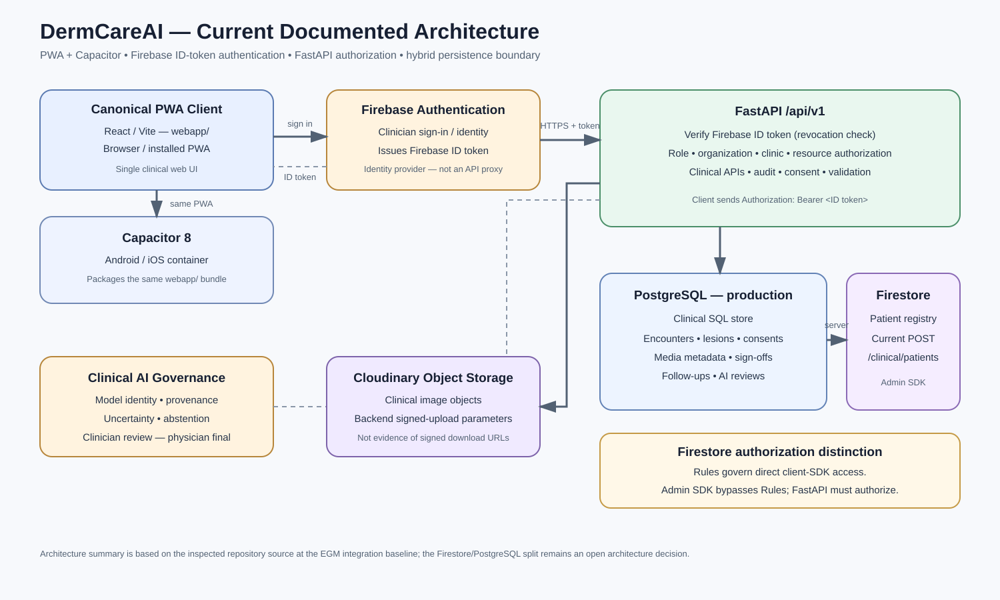
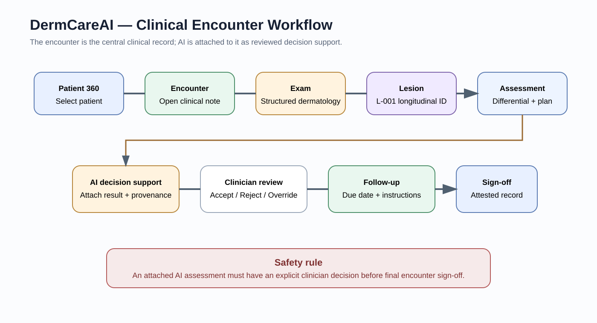
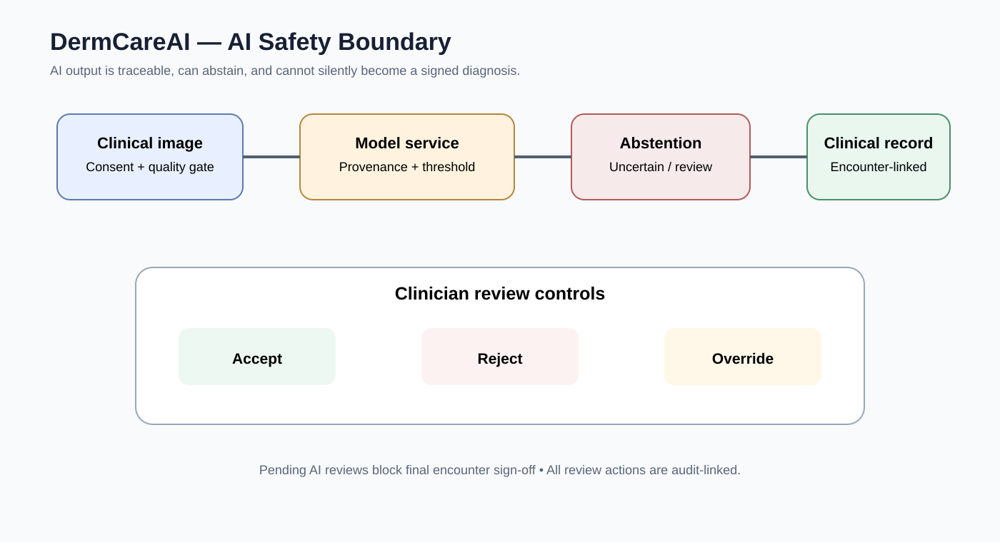
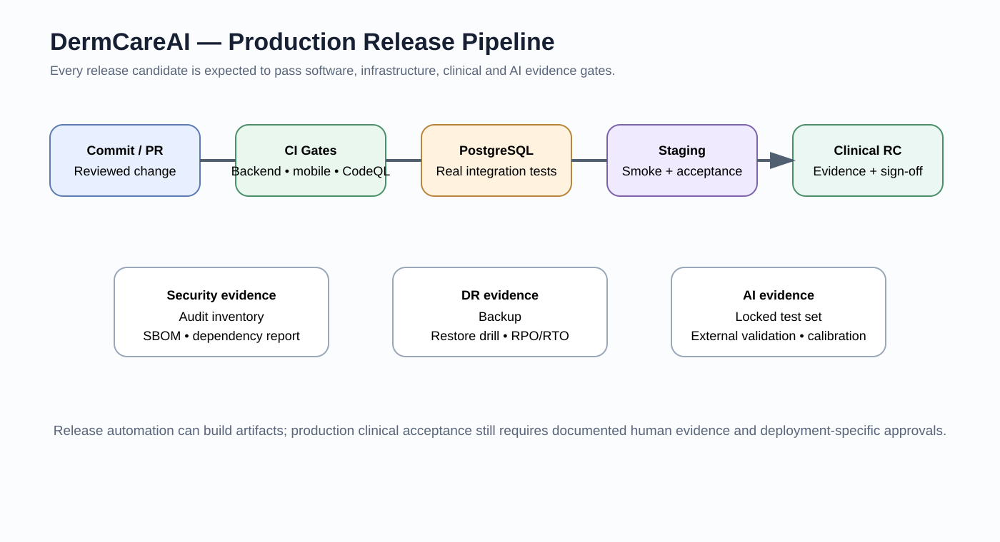

# DermCareAI — Dermatology Clinic Operating System

DermCareAI is a healthcare-oriented dermatology clinic platform for **Patient 360, encounter documentation, longitudinal lesion tracking, AI-assisted image review, billing, pharmacy, notifications, auditability and production operations**.

> ⚠️ **Clinical boundary:** AI output is decision support, not a diagnosis. The research HAM10000 model is not clinically validated for routine patient care. Clinical deployment requires intended-use review, independent validation and applicable regulatory/privacy approvals.

> 🔐 **Persistence boundary:** PostgreSQL is required in production for the clinical workflow SQL store (encounters, lesions, consents, clinical-media metadata, sign-offs, follow-ups and AI reviews). The current patient-registration API path writes its patient-registry document to Firestore through the Firebase Admin SDK. This hybrid boundary is documented in [Firebase Setup](docs/FIREBASE_SETUP.md) and the [platform baseline](docs/designs/DERMCAREAI_PLATFORM_BASELINE.md); do not treat Firestore as unused or rely on Firestore Rules to authorize Admin-SDK calls.

## Visual architecture

The repository uses local SVG diagrams so documentation renders without an external image host.

| Visual | Purpose |
| --- | --- |
| [Production architecture](docs/assets/architecture.svg) | Client, authentication, API, AI governance, object storage and PostgreSQL |
| [Clinical encounter workflow](docs/assets/clinical-workflow.svg) | Patient 360 → encounter → examination → lesion → assessment → review → sign-off |
| [AI safety boundary](docs/assets/ai-safety.svg) | Consent, quality gate, model provenance, abstention and clinician controls |
| [Production release pipeline](docs/assets/release-pipeline.svg) | CI, database, staging, security, DR and clinical/AI evidence gates |

### Production architecture



### Clinical encounter workflow



### AI safety boundary



### Release pipeline



## Current platform architecture

```text
Browser
  └── React/Vite PWA (webapp/)
        └── Firebase Authentication sign-in
              └── Firebase ID token returned to client
                    └── HTTPS request to FastAPI
                          Authorization: Bearer <Firebase ID token>

Capacitor Android/iOS
  └── packages the same webapp/ PWA bundle
        └── uses the same authentication and API flow

FastAPI persistence paths
  ├── PostgreSQL: encounters, lesions, consents, media metadata,
  │               sign-offs, follow-ups and AI reviews
  ├── Firestore Admin SDK: current POST /api/v1/clinical/patients registry write
  └── Cloudinary: backend-issued signed-upload authorization
```

- `webapp/` is the canonical clinical client.
- PWA is the primary application surface.
- Capacitor wraps the same web bundle for Android/iOS; it is not a second clinical UI.
- Firebase Authentication is the identity boundary.
- FastAPI is the authenticated clinical API boundary.
- PostgreSQL is required in production for the SQLAlchemy clinical workflow store (encounters, lesions, consents, media metadata, sign-offs, follow-ups and AI reviews).
- The current patient-registration API path writes a patient-registry document to Firestore through the Firebase Admin SDK. This is a hybrid persistence boundary that requires an explicit architecture decision; this PR does not migrate it.
- Firestore Rules govern direct client-SDK Firestore access. They do not authorize backend Admin-SDK operations; FastAPI must enforce role, tenant and resource authorization itself.
- Clinical offline synchronization is replay-safe/conflict-aware application logic; do not enable Firestore persistence as an unreviewed cache workaround.

## Clinical AI safety boundary

Clinical AI is deliberately separated into a lower-risk assistive lane and a high-consequence diagnostic lane.

```text
Clinical encounter
      │
      ▼
Consent + input validation
      │
      ▼
Clinical AI Assist (optional)
      │
      ▼
Suggestion-only output
      │
      ├── Accept
      ├── Reject
      └── Override
      │
      ▼
Treating physician decision
      │
      ▼
Signed clinical record
```

The application does not permit AI to silently sign diagnoses, prescribe, place orders, or modify signed clinical records. Production diagnostic AI remains fail-closed behind the evidence/artifact gate documented in [Clinical AI Production Activation](docs/CLINICAL_AI_PRODUCTION_ACTIVATION.md).

## Installation — start here

**Canonical installation guide:** [docs/INSTALLATION.md](docs/INSTALLATION.md)

The installation guide covers prerequisites, backend/frontend setup, Firebase Authentication, tenant claims, Firestore Rules, PostgreSQL staging, PWA validation, Capacitor packaging and the first-install acceptance checklist.

### Fast Windows setup

```powershell
powershell -ExecutionPolicy Bypass -File .\setup-dev.ps1
# or
.\setup-dev.cmd
```

The setup helper installs the hash-locked Python 3.12 backend environment and the frontend dependencies. It then prints the Firebase and canonical installation steps.

## Firebase setup — mandatory for clinical access

The detailed Firebase contract is [docs/FIREBASE_SETUP.md](docs/FIREBASE_SETUP.md).

### Web application

Create a Firebase Web App and configure `webapp/.env`:

```text
VITE_FIREBASE_API_KEY=<web-api-key>
VITE_FIREBASE_AUTH_DOMAIN=<project-id>.firebaseapp.com
VITE_FIREBASE_PROJECT_ID=<project-id>
VITE_FIREBASE_APP_ID=<web-app-id>
```

These are browser configuration values. **Never put Firebase Admin service-account credentials in the frontend.**

### Backend

Configure `backend/.env`:

```text
FIREBASE_AUTH_REQUIRED=true
FIREBASE_SERVICE_ACCOUNT_JSON=<controlled-secret>
```

Keep the service-account credential outside source control and inject it through the organization's approved secret-management mechanism.

### Tenant claims

Use `backend/tenant_bootstrap.py` from a controlled administrative environment:

```bash
cd backend
python tenant_bootstrap.py \
  --uid <firebase-user-uid> \
  --organization-id <organization-id> \
  --clinic-id <clinic-id> \
  --role admin \
  --role doctor
```

Verify `organization_id`, `clinic_id` and `roles` claims, refresh the ID token, then test cross-tenant rejection.

### Firestore

Firestore is not the primary store for the longitudinal clinical workflow tables, but the current patient-registration API path writes its patient-registry record through the Firebase Admin SDK. Deploy the repository rules for direct client-SDK access:

```bash
firebase login
firebase use <project-id>
firebase deploy --only firestore:rules
```

Do not enable Firestore offline persistence for clinical records merely to obtain offline support. See [Firebase Authentication and Firestore Setup](docs/FIREBASE_SETUP.md).

## Architecture design and EGM review workflow

DermCareAI uses the [Elephant-Goldfish Model (EGM)](https://github.com/google/elephant-goldfish-model) as an optional development-time specification and independent design-review workflow. EGM is not a clinical runtime dependency and does not authorize clinical decisions or production releases.

- [EGM integration and operating guide](docs/EGM_INTEGRATION.md)
- [Design specification index](docs/designs/README.md)
- [Initial platform baseline](docs/designs/DERMCAREAI_PLATFORM_BASELINE.md)

Approved designs belong in `docs/designs/`. Working drafts belong in the ignored `.dev/docs/` directory until reviewed. EGM reviews do not replace human architecture, security, privacy, or clinical approval.

## Development

### Backend

```powershell
cd backend
.\.venv\Scripts\Activate.ps1
python -m uvicorn app:app --reload --host 0.0.0.0 --port 8000
```

Validation:

```powershell
pytest -q tests
python -m compileall -q .
```

### PWA

```powershell
cd webapp
npm run dev -- --host 0.0.0.0
```

Validation:

```powershell
npm run lint
npm run test -- --run
npm run build
```

### Capacitor

Android:

```bash
cd webapp
npm run cap:android
```

iOS on macOS + Xcode:

```bash
cd webapp
npm run cap:ios
```

The Capacitor configuration uses app ID `com.dermcareai.clinic` and web directory `dist`. Native projects are generated/synchronized when native packaging is enabled.

## Local PostgreSQL staging

```bash
docker compose -f docker-compose.staging.yml up --build
docker compose -f docker-compose.staging.yml exec backend python scripts/migrate_postgres.py
```

Use staging/test data only. Never place real patient data in local development environments.

## Production engineering gates

The repository includes automated gates for backend regression, PWA/Capacitor regression, PostgreSQL integration, staging acceptance, CodeQL, Firestore Rules, dependency auditing, production-preflight contracts and continuous evaluation.

Passing software CI is **necessary engineering evidence, not clinical validation or regulatory approval**.

## Production readiness status

| Area | Status |
| --- | --- |
| PWA canonical client | ✅ Implemented |
| Capacitor Android/iOS integration | ✅ Configuration and CI gates implemented; native packaging remains environment-dependent |
| Firebase Authentication | ✅ Integrated |
| Tenant claims / authorization | ✅ Implemented |
| Firestore Rules | ✅ Present and CI-tested for direct client-SDK access; backend Admin-SDK patient-registry writes require API-level authorization |
| PostgreSQL production boundary | ✅ Implemented |
| Clinical AI suggestion-only boundary | ✅ Implemented |
| AI production evidence gate | ✅ Fail-closed |
| Backend/PWA/Capacitor CI | ✅ Automated |
| Independent clinical validation | ⏳ External evidence required |
| Prospective clinical validation | ⏳ External evidence required |
| Regulatory/privacy assessment | ⏳ Organization-specific review required |
| Production cloud deployment | ⏳ Environment and accountable approval required |

See [Wave 5 Release Evidence Status](docs/WAVE5_RELEASE_EVIDENCE_STATUS.md).

## Repository layout

```text
.
├── backend/                  # FastAPI clinical platform and tests
├── webapp/                   # Canonical React/Vite PWA + Capacitor
├── docs/
│   ├── assets/               # Local architecture/workflow diagrams
│   ├── INSTALLATION.md       # Canonical installation guide
│   ├── FIREBASE_SETUP.md     # Firebase-specific setup contract
│   ├── PLATFORM_MIGRATION_ACCEPTANCE.md
│   ├── DEPENDENCY_SECURITY.md
│   ├── PRIVACY_OPERATIONS.md
│   └── CLINICAL_AI_PRODUCTION_ACTIVATION.md
├── firestore.rules
├── firebase.json
├── docker-compose.staging.yml
├── setup-dev.ps1
└── .github/workflows/        # CI/release gates
```

## Security and governance

Production controls include Firebase authentication, tenant-aware RBAC, clinical-media consent enforcement, decoded/MIME-verified image validation, server-side object-storage signing, payment integrity controls, pharmacy transaction controls, hash-chained audit events, fail-closed production CORS, PostgreSQL production enforcement, CodeQL, dependency gates and SBOM/provenance-enabled container releases.

See [SECURITY.md](SECURITY.md) and [Privacy Operations](docs/PRIVACY_OPERATIONS.md).

## Clinical / regulatory boundary

DermCareAI does not claim regulatory approval or clinical validation. For India, release review should assess applicable CDSCO medical-device/software requirements, DPDP obligations, institutional privacy/consent/retention/incident controls, pharmacy requirements, payment-provider requirements and professional/clinical governance.

## Key documents

- [Installation Guide](docs/INSTALLATION.md)
- [Firebase Setup](docs/FIREBASE_SETUP.md)
- [Documentation Drift Register](docs/DOCUMENTATION_DRIFT_REGISTER.md)
- [Platform Migration Acceptance](docs/PLATFORM_MIGRATION_ACCEPTANCE.md)
- [Platform Migration Architecture](docs/PLATFORM_MIGRATION_ARCHITECTURE.md)
- [Dependency Security](docs/DEPENDENCY_SECURITY.md)
- [Privacy Operations](docs/PRIVACY_OPERATIONS.md)
- [Clinical AI Production Activation](docs/CLINICAL_AI_PRODUCTION_ACTIVATION.md)
- [Wave 5 Release Evidence Status](docs/WAVE5_RELEASE_EVIDENCE_STATUS.md)

## License

See the repository for the applicable project licensing and dependency notices.
