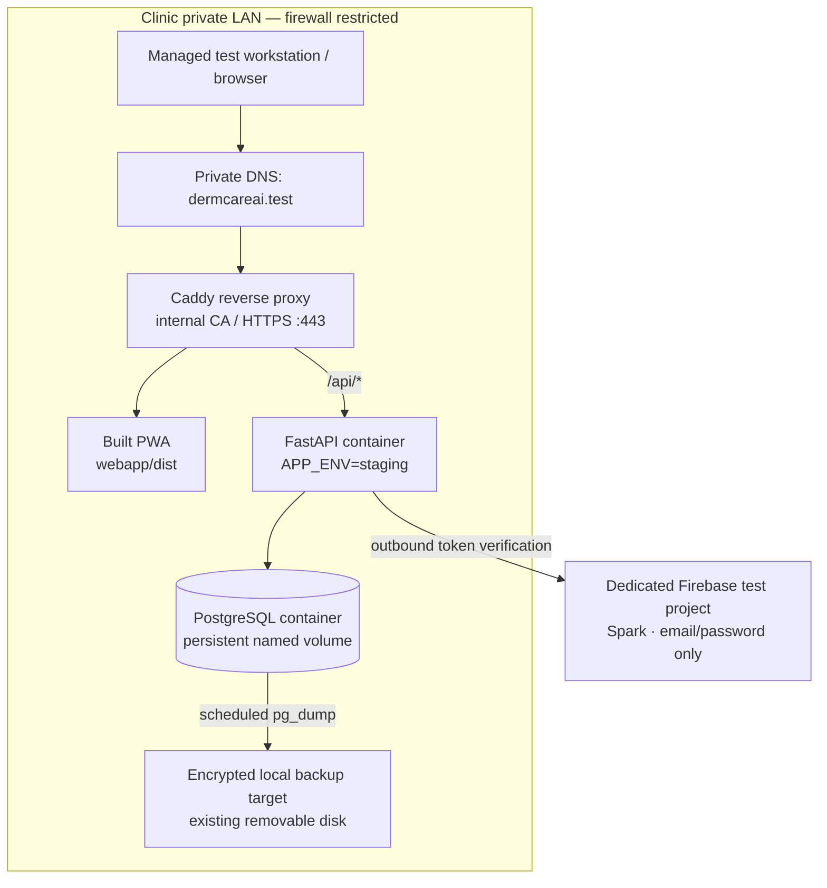

# DermCareAI — Zero-Cost Internal Deployment Plan

**Status:** Proposed implementation plan — not deployed  
**Target:** Internal engineering / workflow evaluation only  
**Budget:** ₹0 incremental monthly infrastructure spend  
**Data policy:** Synthetic test data only. No live patient data, PHI, production patient images, or copied production database.

> **Release boundary:** This plan does not authorize production deployment. Do not use this environment for real clinical decisions or patient records. Production use remains blocked until the clinic's privacy, security, backup/recovery, clinical, regulatory and accountable approval gates are completed.

## 1. Decision summary

For a strict zero-incremental-cost internal pilot, use an **existing, clinic-controlled Linux workstation or server on the private clinic LAN**. Run the PWA, FastAPI backend and PostgreSQL with Docker Compose. Serve the PWA and reverse-proxy API requests through one internal HTTPS endpoint. Keep PostgreSQL and FastAPI off the host's published ports.

This option avoids cloud subscriptions, usage-metered compute, paid domains and public exposure. It is ₹0 in *new hosting charges only when suitable hardware, storage, LAN, electricity and network service already exist*. Those existing operating costs and hardware depreciation are not zero.

Do not create paid Google Cloud, Vercel, Cloudflare Workers, Neon, Oracle or other cloud resources for this phase. Do not attach a payment method to a cloud account for this plan.

### Why not use a free cloud database as the internal default?

Free tiers have quotas, provider controls and potential overage or service-availability constraints. Cloud Run, for example, applies a monthly free allowance but charges for usage beyond the allowance; it is not a hard spending cap. Neon Free has compute-hour, storage and transfer limits and scales to zero. Oracle OCI Always Free has useful VM resources, but free instances can be reclaimed after a seven-day period below documented CPU, network and (for A1) memory utilization thresholds. These are optional future evaluation targets, not the chosen internal design.

## 2. Proposed architecture

### Network and trust boundaries

- The reverse proxy is the only application service reachable from the clinic LAN. Publish HTTPS on the host's private interface; firewall it to the selected clinic test subnet.
- Serve the compiled PWA from the reverse proxy and route `/api/*` to the FastAPI service on the private Compose network.
- Do not publish PostgreSQL port 5432 or the FastAPI port 8000 on the host.
- Use a private DNS name (for example, `dermcareai.test`) and an internally issued TLS certificate. Install and trust the internal CA certificate only on managed test devices. PWA service workers require a secure context: HTTPS is required on a LAN hostname (localhost is treated specially by browsers).
- No router port-forwarding, public IP exposure, public tunnel, remote-access gateway or public API endpoint in this phase.
- Permit outbound internet access only as operationally needed for Firebase token verification, OS security updates and controlled image/package retrieval. No patient content is to be sent to third-party services.
- Keep the test environment separate from the production Firebase project, credentials, user accounts, database and storage.

### Container responsibilities

| Service | Responsibility | Exposure |
|---|---|---|
| Caddy (or equivalent) | Internal TLS, static PWA delivery, API reverse proxy | LAN HTTPS only |
| FastAPI | Existing backend image from `backend/Dockerfile` | Compose network only |
| PostgreSQL 16 | Internal test persistence | Compose network only |
| Backup job | Encrypted logical backup and restore verification | Local host only |

Use one FastAPI worker for the small internal pilot unless distributed rate limiting is configured and separately tested. This keeps process-local controls predictable; it is not a production scaling pattern.

**Important:** Do not use `docker-compose.staging.yml` as the persistent internal service definition. The existing staging acceptance workflow deliberately tears down its stack with `docker compose ... down -v`, which deletes its named database volume. Create a separate `docker-compose.internal.yml` for this pilot, with persistent volumes and explicit network/port boundaries.

## 3. Environment and application guardrails

Use a dedicated Firebase **test** project on the Spark no-cost plan, with email/password sign-in only. Most Firebase Authentication methods are listed as no-cost; phone authentication/SMS is not part of this no-cost assumption. Do not enable phone/SMS login.

Minimum internal configuration:

| Setting | Internal pilot policy |
|---|---|
| `APP_ENV` | `staging` (never label this deployment production) |
| `APP_VERSION` | Pinned release version / immutable build identifier |
| `FIREBASE_AUTH_REQUIRED` | `true` |
| `GOOGLE_CLOUD_PROJECT` | Dedicated test Firebase project ID |
| `GOOGLE_APPLICATION_CREDENTIALS` | Path to read-only mounted test service-account file |
| `DATABASE_URL` | PostgreSQL service URL on the Compose network |
| Store-specific database URLs | Leave unset to use the common `DATABASE_URL` fallback, unless a separate test database is deliberately configured |
| `CORS_ORIGINS` | Exact internal HTTPS origin only; no wildcard |
| `ENABLE_EMBEDDED_DERM_MODEL` | `false` |
| `AI_ENABLED_IN_PRODUCTION` | `false` |
| `AI_DIAGNOSTIC_MODE` | `disabled` |
| Cloudinary credentials | Unset; clinical-media cloud uploads unavailable |
| Razorpay credentials | Unset; no payments |
| WhatsApp / SMS credentials | Unset; no outbound messages |
| Social webhook | Unset |

Store the internal environment file outside Git (for example, `/etc/dermcareai/internal.env`) with owner-only permissions. Mount the Firebase test service-account JSON read-only and point `GOOGLE_APPLICATION_CREDENTIALS` to that file; do not place service-account JSON in the PWA, source tree, container image, CI artifacts or chat.

The backend's storage helper falls back from each store-specific database URL to `DATABASE_URL`. A single internal PostgreSQL database can therefore be used for the pilot, with application tables kept in their existing logical stores. Verify the actual initialized stores and health/readiness behavior during acceptance.

Keep the application feature scope honest: the current PWA migration acceptance document de-scopes several legacy workflows (including appointments, billing UI, pharmacy UI and prescription creation/editing). Do not represent those workflows as available simply because the backend contains related modules.

## 4. Cost controls — hard ₹0 incremental target

| Cost area | Control |
|---|---|
| Cloud compute/database | No cloud resource provisioning for this phase |
| Domains / DNS | Private DNS name; no domain purchase |
| TLS | Internal CA; no paid public certificate or external certificate service |
| Identity | Dedicated Firebase Spark project; email/password only; no phone/SMS |
| Media | Cloudinary unset; no external image/object-storage usage |
| Notifications | WhatsApp, SMS and social webhook credentials unset |
| Payments | Razorpay credentials unset |
| Monitoring / logging | Local log rotation and local health checks; no paid telemetry export |
| Backups | Encrypted backup to an already-owned removable disk; no paid cloud bucket |
| Build pipeline | Use existing GitHub CI; do not add paid runners or hosted infrastructure |

### Resource and spend guardrails

1. Do not add a credit card to a cloud provider or upgrade a free-tier account for this pilot.
2. Do not create Cloud Run, Cloud SQL, Neon paid compute, Cloudflare Workers paid plans, OCI paid instances or paid storage.
3. Do not use public tunnel products or register a domain.
4. Cap container CPU and memory after measuring the host; reserve memory for PostgreSQL and the OS. Keep a documented disk ceiling for database volumes and logs.
5. Configure Docker log rotation (size and file count). Do not log authorization headers, tokens, request bodies, patient identifiers or images.
6. Check disk capacity daily during initial evaluation. At 70% usage, alert the operator; at 85%, stop new test writes and resolve capacity before continuing. Never auto-delete database files to free space.
7. Keep package and container image versions pinned. Pull updates deliberately, review changes, and retain the previous known-good image for rollback.
8. No paid optional integrations. A missing credential should mean the integration is unavailable, not a reason to create an account or incur charges.
9. Record actual incremental spend as ₹0 only after confirming that no new subscription, domain, cloud resource, SMS, media or payment service was activated. Existing electricity, hardware, ISP and staff time remain operating costs.

## 5. Host prerequisites

Before implementation, inventory the intended machine. Target a supported 64-bit Linux distribution, Docker Engine + Compose plugin, stable clinic LAN connectivity, a UPS if already available, and sufficient free disk space.

- Minimum planning baseline: 4 CPU cores, 8 GB RAM and 100 GB free SSD storage.
- Preferred for build and test headroom: 4–8 cores, 16 GB RAM and separate space for encrypted backups.
- The host must be clinic-controlled, physically secured, routinely patched and powered on only during approved test windows.
- If no suitable existing host and backup disk are available, stop and request a separately approved budget. Do not silently fall back to cloud free tiers or use a personal workstation as a permanent clinic server.

These are planning thresholds, not a measured capacity guarantee. Actual capacity must be verified with the backend container and synthetic workload.

## 6. Implementation plan and acceptance gates

### Phase 0 — Inventory and approval (no deployment)

- Name the internal technical owner and clinic privacy/security contact.
- Record host OS, CPU, RAM, SSD capacity, UPS, backup disk, LAN subnet, DNS capability and authorized test devices.
- Confirm the test-only purpose and synthetic-data policy.
- Create a dedicated Firebase test project; do not reuse a production project.

**Gate:** Suitable existing host and backup target confirmed; no live patient data; owner and test scope recorded.

### Phase 1 — Secure LAN foundation

- Patch the host, enable host firewall and restrict SSH administration to the admin subnet.
- Define private DNS for `dermcareai.test`.
- Configure Caddy with an internal CA and HTTPS. Install the CA trust certificate on managed test devices.
- Restrict the application listener to the intended clinic subnet. Confirm access from outside the LAN fails.
- Add the internal origin to the dedicated Firebase test project's authorized domains.

**Gate:** HTTPS works from approved test devices; unapproved LAN devices and WAN clients cannot reach the application; no public ingress exists.

### Phase 2 — Persistent containers

- Add a dedicated `docker-compose.internal.yml`; do not alter the CI staging stack.
- Define a private Compose network, persistent PostgreSQL volume, health checks, restart policy and resource limits.
- Build the existing FastAPI backend from `backend/Dockerfile`.
- Build `webapp/dist` with the pinned npm lockfile and serve it through the reverse proxy.
- Publish only the reverse proxy; keep API and database ports private.
- Add log rotation and an operator-readable status/backup script.

**Gate:** Containers start cleanly after a host restart; PostgreSQL data persists across container recreation; no database port is reachable from the LAN.

### Phase 3 — Test identity and secrets

- Enable email/password sign-in in the test Firebase project.
- Create named test accounts and issue minimum tenant/role claims through the controlled tenant bootstrap process.
- Mount the test Firebase service-account file read-only; protect host environment files and backups.
- Leave external media, SMS, WhatsApp, payments and webhook credentials unset.

**Gate:** Authorized test login succeeds; missing/invalid/revoked tokens fail; cross-tenant and wrong-role requests are rejected.

### Phase 4 — Schema and smoke tests

- Run the repository PostgreSQL initializer/migration script against the internal test database.
- Confirm the clinical, commerce, audit and AI-governance stores resolve to the intended PostgreSQL endpoint.
- Check `/api/v1/health/live` and the documented readiness endpoint.
- Verify static PWA loading, API routing, CORS restrictions and browser secure-context/PWA behavior.
- Run existing backend regression, PWA lint, web tests, production build and applicable tenant-safety tests in CI before updating the internal image.
- Test only supported current PWA workflows. Do not create production-like patient datasets or enable diagnostic AI.

**Gate:** All applicable tests pass; application and tenant boundaries work; no clinical data was imported.

### Phase 5 — Backup and restore drill

- Schedule an encrypted `pg_dump` backup to an already-owned removable disk.
- Retain a small, documented rotation for synthetic test data.
- Verify backup file integrity and perform a restore into a separate throwaway database at least monthly and before any schema-changing upgrade.
- Document backup location, encryption key custodian and recovery steps. Keep the removable disk disconnected when not backing up.

**Gate:** Restore succeeds and is repeatable. A backup on the same host disk alone does not count as a recoverable backup.

### Phase 6 — Internal evaluation and handover

- Run a short internal acceptance session with synthetic data and approved test accounts.
- Record defects without adding identifiers, screenshots containing personal information or secrets to GitHub issues.
- Document uptime windows, operator contacts, backup/restore evidence, limitations and stop procedure.
- Stop the pilot if firewall isolation, authentication, tenant isolation, storage capacity or backup integrity fails.

**Gate:** Technical owner signs the internal test report; clinic privacy/security owner acknowledges the synthetic-data-only boundary.

## 7. Mandatory exclusions and production blockers

This internal pilot is **not** a production clinical deployment. Specifically:

- No live patient records, patient names/IDs, real clinical notes, clinical photographs, copied production databases or real prescriptions.
- No clinical diagnosis, autonomous treatment, prescribing, orders or signed-record modification by AI. Diagnostic AI remains disabled and research models remain off.
- No assumption of clinical validation, regulatory approval, privacy certification, production uptime, high availability, disaster recovery or 24/7 support.
- No public access, public tunnels, mobile access from outside the clinic LAN or production domains.
- No claim that privacy export/deletion/retention is automated; the current privacy runbook identifies gaps in these workflows.
- No claim that excluded PWA workflows are available in the current release.

Before any live-data or production transition, separately complete the repository production preflight, environment-specific security assessment, tenant-isolation tests, managed PostgreSQL and backup/restore design, privacy operations approval, vendor/data-processing review, incident response and access governance, clinical workflow validation, applicable India regulatory/privacy review, and accountable clinic sign-off. The production readiness gate must remain fail-closed until those conditions are evidenced.

## 8. Rollback and stop procedure

1. Disable the LAN application listener at the host firewall or stop the reverse proxy.
2. Stop the FastAPI container; keep the PostgreSQL volume intact.
3. Preserve synthetic test logs and the last known-good image digest; do not delete or overwrite database files during incident triage.
4. Restore a known-good image/configuration only after confirming the database schema compatibility.
5. If the host, disk or credentials may be compromised, isolate the machine, revoke test credentials, rotate secrets and rebuild from a known-good image.
6. Do not move the database to a public free-tier service as an emergency shortcut.

## 9. Future alternatives — not activated

- **Cloudflare Pages:** suitable for a later public static preview, not needed for the LAN-only pilot. Its free plan has build and file-count limits; static asset requests are treated differently from Pages Functions.
- **Cloud Run + Neon:** possible low-traffic prototype path, but free allowances are quotas rather than a hard no-bill ceiling. Cloud Run charges after free allowances and Neon Free is limited by compute hours, storage and transfer.
- **OCI Always Free:** a cloud-hosted synthetic-data lab option if no suitable local host exists, but idle-resource reclamation and regional capacity mean it is not the first choice for a dependable internal service.

Any move to a cloud provider requires a new architecture review, a billing/overage decision, provider-region and data-residency review, privacy/security approval and explicit authorization. It must not be inferred from this ₹0 internal pilot request.

## 10. References

Pricing and platform limits checked on **8 November 2026**:

- [Firebase pricing — Spark no-cost plan and authentication](https://firebase.google.com/pricing)
- [Firebase pricing-plan documentation](https://firebase.google.com/docs/projects/billing/firebase-pricing-plans)
- [Cloud Run pricing and free-tier billing behavior](https://cloud.google.com/run/pricing)
- [Neon Free plan quotas](https://github.com/neondatabase/website/blob/main/content/faqs/free-plan-limits-and-quotas.md)
- [Oracle Cloud Always Free resources and idle-instance reclamation](https://docs.oracle.com/en-us/iaas/Content/FreeTier/freetier_topic-Always_Free_Resources.htm)
- [MDN — Service Worker API and secure-context requirement](https://developer.mozilla.org/en-US/docs/Web/API/Service_Worker_API)
- [Repository installation guide](INSTALLATION.md)
- [Repository privacy operations runbook](PRIVACY_OPERATIONS.md)
- [Repository production release evidence status](WAVE5_RELEASE_EVIDENCE_STATUS.md)
